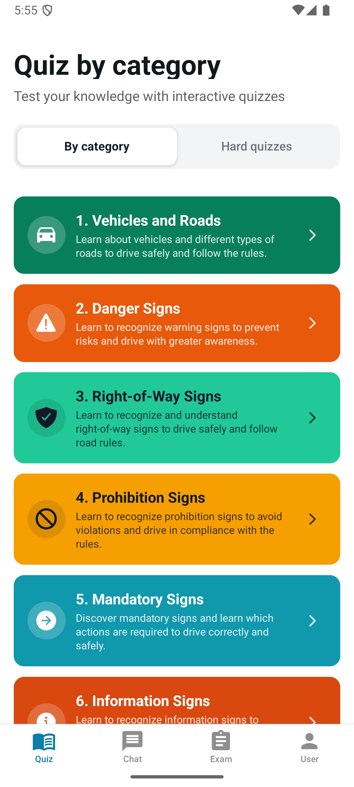
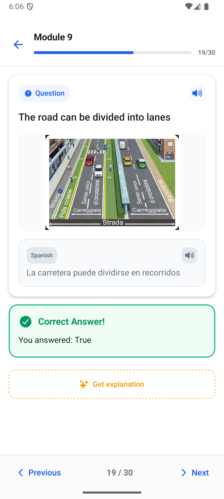
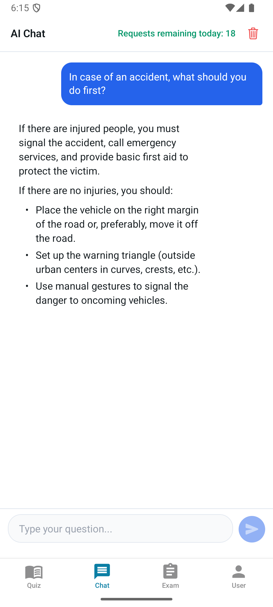

# 🚗 Quiz Patente AI (EasyPatente)
### Full-Duplex Voice AI Tutor & Multimodal RAG Platform for Driving Exam Preparation

<p align="center">
  <a href="http://quizpatenteitaliana.it/">
    
  </a>
  <a href="http://quizpatenteitaliana.it/">
    
  </a>
  
  
  
</p>

<p align="center">
  <b>A production-grade, multi-platform AI ecosystem designed to help foreign and local learners pass the official Italian driving license examination (Patente B). Featuring a low-latency full-duplex conversational voice tutor, multimodal vector search over official driving manuals, and real-time dual-language study modes.</b>
</p>

---

## 🌐 Live Production Application

The platform is deployed live and fully functional in production:

* 🚀 **Main Portal (Apex & All Languages):** [http://quizpatenteitaliana.it/](http://quizpatenteitaliana.it/) *(supports HTTPS via Cloudflare/Vercel)*
* 🇪🇸 **Spanish Dedicated Portal:** [https://es.quizpatenteitaliana.it](https://es.quizpatenteitaliana.it)
* 🇧🇩 **Bengali Dedicated Portal:** [https://bn.quizpatenteitaliana.it](https://bn.quizpatenteitaliana.it)

> **No app installation required for testing:** Open the web app on any desktop or mobile browser to test the interactive quiz engine, multilingual interface, and real-time AI tutor.

---

## 📸 Screenshots & Interface Showcase

<p align="center">
  
  &nbsp;&nbsp;&nbsp;&nbsp;
  
  &nbsp;&nbsp;&nbsp;&nbsp;
  
</p>

---

## 🌟 Key Architectural & Product Highlights

### 🎙️ 1. Full-Duplex Real-Time Voice AI Tutor (Gemini 3.8 Live API)
* **Bidirectional Low-Latency Audio Streaming:** WebSocket proxy implemented on Supabase Edge Functions (`Deno.upgradeWebSocket`) streaming raw PCM16 (16 kHz) audio via browser `AudioWorklet`.
* **Natural Barge-In & Voice Activity Detection (VAD):** Allows natural interruptions; user speech cancels downstream synthesis in real time.
* **Strict Grounded RAG (`behavior="BLOCKING"`):** Before the assistant responds verbally, Gemini triggers a server-side `retrieve_manual_context` tool call against `pgvector`. This guarantees the voice agent never hallucinates regulatory road laws.
* **Fast-Path Context Cache:** When launching the voice session directly from a quiz question, question metadata and pre-retrieved manual chunks are injected instantly (~50ms fast path) bypassing redundant vector queries.
* **Unified State & Quotas:** Real-time audio and transcription events are synchronized directly to PostgreSQL chat history with shared daily token quotas.

### 🧠 2. Multimodal Vision RAG (Retrieval-Augmented Generation)
* **Official Manual Indexing:** 300+ pages of the official Italian Highway Code manual digitized via Vision-LLM OCR, semantically split, and embedded into a 768-dimensional space using `EmbeddingGemma 300M` with PostgreSQL `pgvector`.
* **Visual Context Understanding:** Passing road sign illustrations and complex junction diagrams directly to multimodal vision models (Gemini Flash / Qwen-VL) to explain spatial priorities and signage rules.
* **Persistent Deduplicated Cache:** AI explanations are persistently cached in PostgreSQL per question and locale, slashing recurring API costs and delivering sub-100ms subsequent response times.

### 🌐 3. Simultaneous Dual-Language Interface & Subdomain SEO
* **Designed for International Learners:** Solves the major roadblock for foreign candidates by rendering official Italian quiz questions alongside their native language (13+ supported languages including Bengali, Spanish, English, Urdu, Hindi, Arabic, etc.).
* **One-Click Language Swap:** Instant toggle between primary and secondary display for immersion learning.
* **Subdomain-Based Multi-Tenancy:** Automated routing based on hostname (e.g., `bn.quizpatenteitaliana.it`), dynamically configuring language constraints, tailored meta tags, canonical URLs, and `hreflang` headers for SEO.

### ⏱️ 4. Ministry Exam Simulator & Performance Analytics
* **Official Examination Conditions:** 30 questions, 20-minute countdown timer, max 3 allowable errors, mimicking the real ministerial tablet exam.
* **Mistake History & Weakness Analytics:** Drill down by topic (signals, right of way, speeds, safety distance) to focus revision on error-prone categories.
* **Built-in Text-to-Speech (TTS):** Native auditory reading of quiz questions in Italian and secondary languages.

---

## 📐 System Architecture

```
┌─────────────────────────────────────────────────────────────────────────────────────────────┐
│                                    CLIENT PLATFORMS                                         │
│                                                                                             │
│   React Native (Expo SDK 55) • Web (AudioWorklet PCM16) • iOS & Android Mobile Builds      │
│   Zustand Global State (7 decoupled stores) • i18next Dual-Language Engine                  │
└───────────────────────────────┬─────────────────────────────┬───────────────────────────────┘
                                │ HTTPS / REST                │ WSS (WebSockets)
                                ▼                             ▼
┌─────────────────────────────────────────────────────────────────────────────────────────────┐
│                                 SUPABASE CLOUD INFRASTRUCTURE                               │
│                                                                                             │
│  ┌───────────────────────────────┐ ┌───────────────────────────┐ ┌───────────────────────┐ │
│  │     Edge Function: explain    │ │   Edge Function: live     │ │  Edge Function: chat   │ │
│  │ (RAG + Vision LLM + Cache)    │ │ (WebSocket Proxy to Live) │ │ (Text RAG + History)   │ │
│  └───────────────┬───────────────┘ └─────────────┬─────────────┘ └───────────┬───────────┘ │
│                  │                               │                           │             │
│  ┌───────────────┴───────────────────────────────┴───────────────────────────┴───────────┐ │
│  │                           PostgreSQL Database (Supabase)                              │ │
│  │  • pgvector (768-dim manual embeddings)    • question_translations (L1 Cache)         │ │
│  │  • chat_messages & session quotas          • Supabase Auth & Row Level Security (RLS) │ │
│  │  • Storage Bucket (High-res sign assets)   • Feature flags (Dynamic runtime config)   │ │
│  └───────────────────────────────────────────────┬───────────────────────────────────────┘ │
└──────────────────────────────────────────────────┼─────────────────────────────────────────┘
                                                   │
                         ┌─────────────────────────┴─────────────────────────┐
                         ▼                                                   ▼
         ┌───────────────────────────────┐                   ┌───────────────────────────────┐
         │     Gemini 3.8 Live API       │                   │    Vector Embedding Engine    │
         │  • Full-Duplex Audio & Text   │                   │  • Cloudflare Workers AI      │
         │  • Blocking Function Calling  │                   │    (@cf/google/embeddinggemma)│
         │  • Real-time Transcription    │                   │  • Local LM Studio Fallback   │
         └───────────────────────────────┘                   └───────────────────────────────┘
```

---

## 🔬 Engineering Decisions & Benchmarks

| Component | Technical Solution | Rationale / Benchmark |
|---|---|---|
| **Voice Mode** | Full-Duplex over WebSockets (`gemini-3.8-live`) | Eliminates push-to-talk awkwardness; native VAD handles interruptions seamlessly. |
| **Voice Grounding** | Server-intercepted `retrieve_manual_context` | Prevents hallucinations by forcing vector chunk retrieval before speech synthesis starts. |
| **Voice Latency** | Re-ranking disabled on live voice stream | Saved 300–800ms per turn to maintain a real-time conversational cadence (~2s total turnaround). |
| **Explanation Cache** | Persisted relational DB cache | Zero cost and <50ms response for repeated questions across the user community. |
| **Subdomain Handling** | Dynamic hostname detection (`lib/siteConfig.ts`) | Single codebase handles apex and localized portals (`bn.`, `es.`) without code duplication. |
| **Audio Pipeline** | Web Audio API + AudioWorklet (16 kHz PCM) | Zero external heavy native dependencies for web client; cleanest browser audio capture. |

---

## 🛠️ Technology Stack

### Frontend & Mobile Client
* **Framework:** React Native, Expo SDK 55, Expo Router (File-based Routing)
* **State Management:** Zustand (decoupled stores: user, quiz, chat, voice, exam, feature flags)
* **Audio & Media:** Web AudioWorklet (PCM16 streaming), Expo Speech (TTS), Expo Image
* **Styling & UI:** Vanilla React Native StyleSheet architecture with strict design tokens

### Cloud Backend & Database
* **Database:** Supabase PostgreSQL with `pgvector` vector extension
* **Authentication & Security:** Supabase Auth (JWT), Row Level Security (RLS) policies
* **Serverless Compute:** Deno-based Supabase Edge Functions (`live`, `explain-question`, `chat`)
* **Storage:** Supabase Object Storage (road signs and visual quiz diagrams)

### AI & Data Engineering
* **Live Conversational Model:** Google Gemini 3.8 Live API (WebSocket full-duplex)
* **Multimodal Vision & Text Models:** Google Gemini Flash API & Local LLMs via LM Studio (`gemma-4-26b`, `Qwen-2.5-VL`)
* **Embeddings:** Cloudflare Workers AI (`EmbeddingGemma 300M`, 768 dimensions)
* **Data Processing Pipelines:** Python scripts for PDF OCR extraction, chunking, and Excel quiz ingestion

---

## 📁 Repository Structure

```
easyPatente/
├── app/                      # Expo Router application screens
│   ├── (tabs)/               # Core navigation: Home, Exam, Chat (Text & Voice), Profile
│   ├── quiz.tsx              # Interactive quiz runner (Dual-language, AI Explanations, TTS)
│   ├── examQuiz.tsx          # Timed official exam simulation mode
│   └── login.tsx / signup.tsx# Authentication flows
├── components/               # Modular UI components (Audio bars, Modals, Cards)
├── hooks/                    # Business logic and custom React hooks
├── store/                    # Zustand global stores (voice, chat, quiz, user)
├── lib/                      # Live audio worklets, WebSocket session manager, Supabase client
├── supabase/                 # Database migrations & Serverless Edge Functions
│   └── functions/
│       ├── live/             # WebSocket proxy for Gemini 3.8 Live API & RAG interception
│       ├── explain-question/ # Vector RAG + Multimodal Vision explanation endpoint
│       └── chat/             # Conversational text RAG endpoint with session memory
├── ragPipeline/              # Python RAG indexing pipeline (PDF → Vision OCR → Chunks → Vector DB)
├── quizConverter/            # Python data ingestion pipeline for official ministerial quizzes
└── doc/                      # Project documentation and architectural plans
```

---

## 🚀 Local Development Setup

### 1. Prerequisites
* Node.js (v18+)
* Expo CLI (`npx expo`)
* Supabase CLI (optional for local functions/database)

### 2. Installation

```bash
# Clone the repository
git clone https://github.com/luigidalleaste/easyPatente.git
cd easyPatente

# Install dependencies
npm install

# Configure environment variables
cp .env.example .env
```

### 3. Environment Variables (`.env`)

```env
EXPO_PUBLIC_SUPABASE_URL=https://your-project.supabase.co
EXPO_PUBLIC_SUPABASE_PUBLISHABLE_KEY=your-anon-key
EXPO_PUBLIC_SUPABASE_STORAGE_URL=https://your-project.supabase.co/storage/v1/object/public/easypatente
```

### 4. Running the App

```bash
# Start development server for Web, iOS, or Android
npx expo start

# Run specifically on web
npx expo start --web
```

---

## 👤 Author & Contact

**Luigi Dalle Aste**  
* GitHub: [@luigidalleaste](https://github.com/luigidalleaste)  
* Production App: [http://quizpatenteitaliana.it/](http://quizpatenteitaliana.it/)
